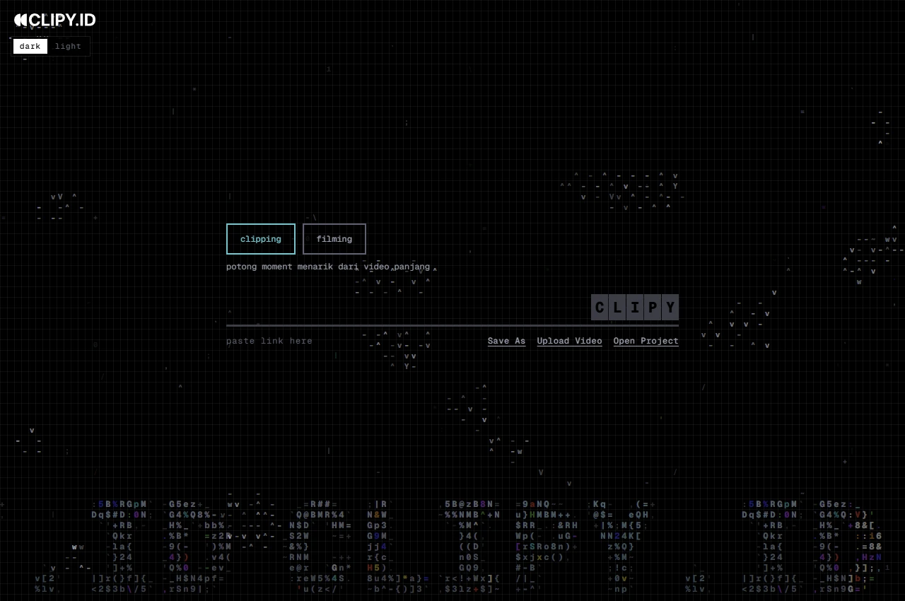
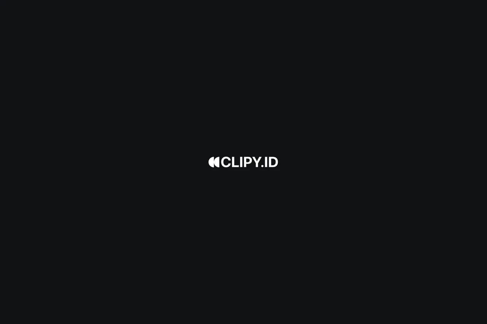

# CLIPY.ID

Aplikasi desktop untuk membuat klip pendek dan rangkuman cerita dari video YouTube atau file lokal. CLIPY.ID membantu memilih momen, menyesuaikan crop, membuat caption, dan menyiapkan video untuk dibagikan.



<details>
<summary>Layar pembuka</summary>



</details>

## Install

Siapkan [prasyarat sistem](#prasyarat) sekali. Perintah di bawah mengambil kode sumber, memasang dependensi proyek, lalu membuka jendela CLIPY.ID. Kompilasi pertama bisa memakan waktu beberapa menit.

**Windows (PowerShell)**

```powershell
irm https://raw.githubusercontent.com/nativmedia/CLIPY.ID-Client/main/install.ps1 | iex
```

**macOS dan Linux**

```sh
curl -fsSL https://raw.githubusercontent.com/nativmedia/CLIPY.ID-Client/main/install.sh | sh
```

Lokasi kode setelah pemasangan

- Windows — `%LOCALAPPDATA%\CLIPY.ID-Client`
- macOS — `~/Library/Application Support/CLIPY.ID-Client`
- Linux — `~/.local/share/CLIPY.ID-Client` atau di bawah `$XDG_DATA_HOME` jika disetel

Tutup CLIPY.ID sebelum menjalankan ulang perintah instalasi untuk mengambil perubahan terbaru dari GitHub, atau buka folder tersebut dan jalankan **npm run dev:desktop** untuk memakai salinan yang sudah terpasang.

## Jalankan dari kode sumber

```sh
git clone https://github.com/nativmedia/CLIPY.ID-Client.git
cd CLIPY.ID-Client
npm ci
npm run setup
npm run dev:desktop
```

Di PowerShell Windows, gunakan `npm.cmd` jika perintah `npm` diblokir oleh kebijakan skrip.

**npm run setup** menyiapkan lingkungan Python lokal dan dua model crop. Setelah itu cukup gunakan **npm run dev:desktop** untuk membuka aplikasi lagi. Selesaikan pekerjaan video yang sedang berjalan sebelum menutup jendela.

## Prasyarat

Semua platform memerlukan Git, Node.js 24 LTS dengan npm, Python 3.12, Rust stable, serta FFmpeg dan FFprobe dengan libass dan libx264. Gunakan versi yang sudah terpasang jika memenuhi syarat.

| Sistem | Kebutuhan tambahan |
| --- | --- |
| Windows x64 | Microsoft C++ Build Tools dengan workload **Desktop development with C++** dan WebView2 Runtime. Untuk FFmpeg, gunakan **winget install --id Gyan.FFmpeg --exact**. |
| macOS 15 Apple Silicon dan Intel | Jalankan **xcode-select --install** untuk memasang Xcode Command Line Tools. Pasang Python dan FFmpeg melalui Homebrew dengan perintah di bawah. |
| Linux x64 (Ubuntu 24.04) | Gunakan sesi desktop dengan WebKitGTK 4.1. Pasang paket di bawah dan Node.js 24 melalui pengelola versi atau metode instalasi Node.js pilihan Anda. |

Detail toolchain tersedia di [panduan Tauri](https://v2.tauri.app/start/prerequisites/).

```sh
# macOS
brew install python@3.12 ffmpeg@7 portaudio
export PATH="$(brew --prefix ffmpeg@7)/bin:$PATH"
```

```sh
# Ubuntu 24.04
sudo apt update
sudo apt install git curl build-essential python3.12 python3.12-venv ffmpeg \
  libwebkit2gtk-4.1-dev libssl-dev libxdo-dev libayatana-appindicator3-dev \
  librsvg2-dev libgl1 libportaudio2 gstreamer1.0-libav gstreamer1.0-plugins-good xdg-utils
```

## Cara kerja

- Antarmuka Vite berjalan di dalam jendela Tauri. Peluncur menyalakan API FastAPI secara lokal dan menghentikannya saat jendela ditutup.
- Masukkan API key dari penyedia yang didukung melalui aplikasi. Transkripsi lokal pertama bisa mengunduh model Whisper sekitar 3 GB.
- Proyek, pengaturan, dan hasil lokal tersimpan di **server/data**.

## Memperbarui aplikasi

`npm run dev:desktop` memakai kode di folder lokal. Untuk mengambil versi terbaru, tutup aplikasi dan jalankan perintah berikut dari folder repo.

```sh
git pull --ff-only
npm run dev:desktop
```

Jika dependensi ikut berubah, jalankan `npm ci` dan `npm run setup` setelah `git pull`, lalu buka aplikasi. Jika memakai perintah instalasi satu baris di atas, jalankan ulang perintah tersebut untuk mengambil pembaruan dan menyiapkan dependensi.

[Panduan mode web, pengaturan, dan pemecahan masalah](docs/web.md)
